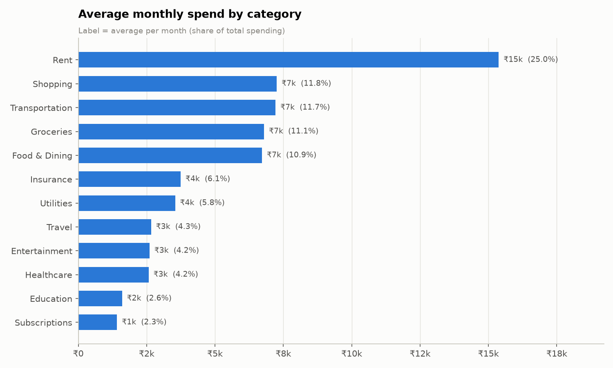
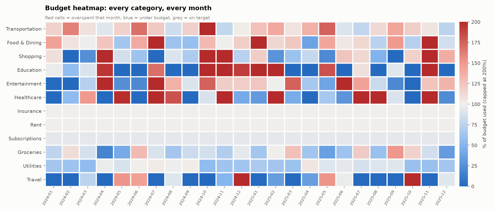
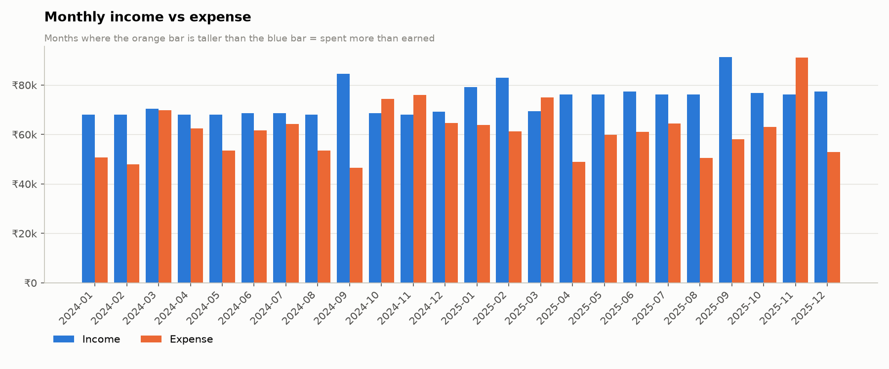
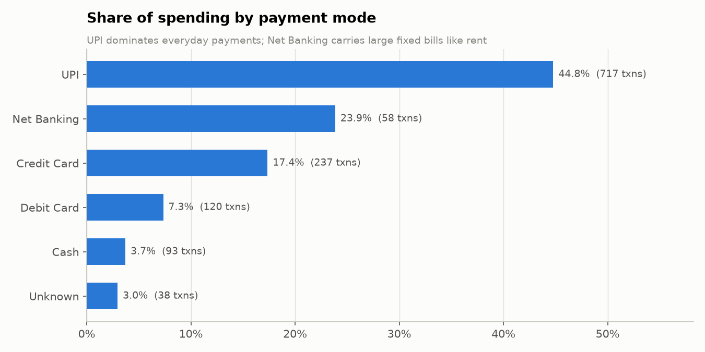
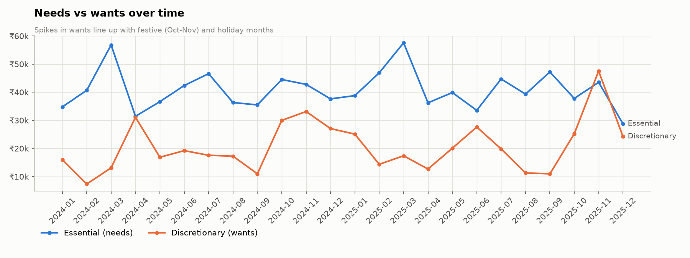

# Personal Expense Tracker & Budget Dashboard: Insights Report

*Generated automatically on 26 November 2026 by `src/report_generator.py`*

## 1. Headline numbers (24 months)

| Metric | Value |
|---|---|
| Total income | ₹1,773,015 |
| Total expense | ₹1,475,784 |
| Net savings | ₹297,232 |
| Savings rate | 16.8% |
| Average monthly expense | ₹61,491 |
| Expense transactions | 1,263 |
| Top spending category | Rent |

## 2. Key insights

1. Over 24 months the user earned ₹1,773,015 and spent ₹1,475,784, saving ₹297,232 (savings rate 16.8%).
2. Top 3 spending categories: Rent (25.0%), Shopping (11.8%), Transportation (11.7%) - together 48.5% of all spending.
3. Best month: 2024-09 (saved ₹38,016). Worst month: 2025-11 (net -₹14,858).
4. Spending exceeded income in 4 month(s): 2024-10, 2024-11, 2025-03, 2025-11.
5. Transportation went over budget in 18 of 24 months (overall 120.2% of budget used).
6. Food & Dining went over budget in 15 of 24 months (overall 116.8% of budget used).
7. Shopping went over budget in 10 of 24 months (overall 111.6% of budget used).
8. 50/30/20 check: savings are 16.8% of income, which is below the 20% target; wants take 28.0% (target 30%).
9. 93.3% of spending is digital; UPI alone is 44.8%.
10. Festive effect: Shopping in Oct-Nov is 3.9x a normal month - plan a dedicated Diwali fund.

## 3. Recommendations

1. Review the Transportation budget: when it is exceeded, overspend averages ₹1,956.
2. Review the Food & Dining budget: when it is exceeded, overspend averages ₹2,498.
3. Review the Shopping budget: when it is exceeded, overspend averages ₹6,722.
4. Cutting food-delivery spend by 20% would save about ₹16,121 per year.
5. Automate a fixed SIP/RD transfer on salary day so the 20% savings target is met first.

## 4. Spending by category

| category | total_spent | avg_per_month | share_pct |
|---|---|---|---|
| Rent | ₹369,000 | ₹15,375 | 25.0% |
| Shopping | ₹174,154 | ₹7,256 | 11.8% |
| Transportation | ₹173,108 | ₹7,213 | 11.7% |
| Groceries | ₹163,017 | ₹6,792 | 11.1% |
| Food & Dining | ₹161,214 | ₹6,717 | 10.9% |
| Insurance | ₹89,800 | ₹3,742 | 6.1% |
| Utilities | ₹85,003 | ₹3,542 | 5.8% |
| Travel | ₹63,925 | ₹2,664 | 4.3% |
| Entertainment | ₹62,476 | ₹2,603 | 4.2% |
| Healthcare | ₹61,699 | ₹2,571 | 4.2% |
| Education | ₹38,404 | ₹1,600 | 2.6% |
| Subscriptions | ₹33,984 | ₹1,416 | 2.3% |

## 5. Budget performance

| category | total_budget | total_actual | utilisation_pct | months_over_budget | status |
|---|---|---|---|---|---|
| Transportation | ₹144,000 | ₹173,108 | 120.2% | 18 | Over Budget |
| Food & Dining | ₹138,000 | ₹161,214 | 116.8% | 15 | Over Budget |
| Shopping | ₹156,000 | ₹174,154 | 111.6% | 10 | Over Budget |
| Education | ₹36,000 | ₹38,404 | 106.7% | 10 | Over Budget |
| Entertainment | ₹60,000 | ₹62,476 | 104.1% | 12 | Over Budget |
| Healthcare | ₹60,000 | ₹61,699 | 102.8% | 9 | Over Budget |
| Insurance | ₹89,800 | ₹89,800 | 100.0% | 0 | Near Limit |
| Rent | ₹369,000 | ₹369,000 | 100.0% | 0 | Near Limit |
| Subscriptions | ₹36,000 | ₹33,984 | 94.4% | 0 | Near Limit |
| Groceries | ₹198,000 | ₹163,017 | 82.3% | 6 | Near Limit |
| Utilities | ₹108,000 | ₹85,003 | 78.7% | 4 | Within Budget |
| Travel | ₹108,000 | ₹63,925 | 59.2% | 5 | Within Budget |

## 6. Cash flow

## 7. Behaviour

## 8. Data-quality work performed

- Loaded raw data: 1,335 rows, 8 columns
- Removed 26 duplicate rows
- Standardised 196 dates written in non-ISO formats; dropped 0 unparseable dates
- Converted 104 text amounts to numbers; fixed 13 negative amounts; dropped 0 rows with no amount
- Standardised 52 transaction-type labels (DR/CR -> Debit/Credit)
- Standardised 99 inconsistent category spellings
- Filled 26 of 26 missing categories using merchant name (0 left as 'Uncategorised')
- Filled 39 missing payment modes with 'Unknown' (not guessed, to stay honest)
- Removed 4 data-entry errors (amount > 20x merchant median): Office Canteen ₹7,235, Office Canteen ₹19,430, Haldiram's ₹72,669, Starbucks ₹80,856
- Flagged 85 genuine large spends using the IQR rule (kept in data)
- Added features: year, month, month_name, year_month, quarter, day_of_week, is_weekend, signed_amount, expense_type, cost_nature, is_large_spend
- Final clean data: 1,305 rows, 19 columns, 0 missing values remaining
