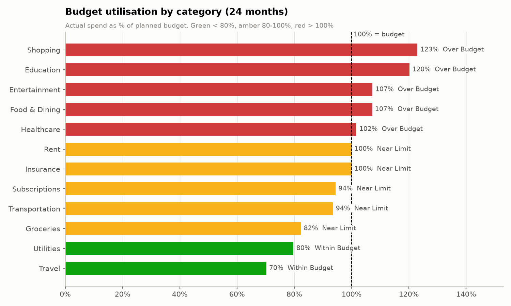
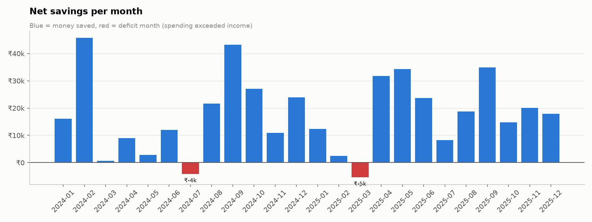
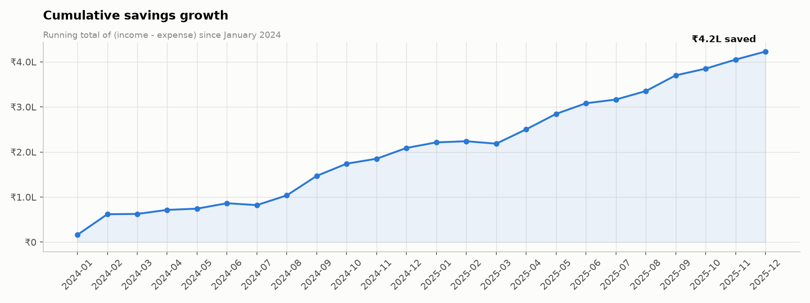
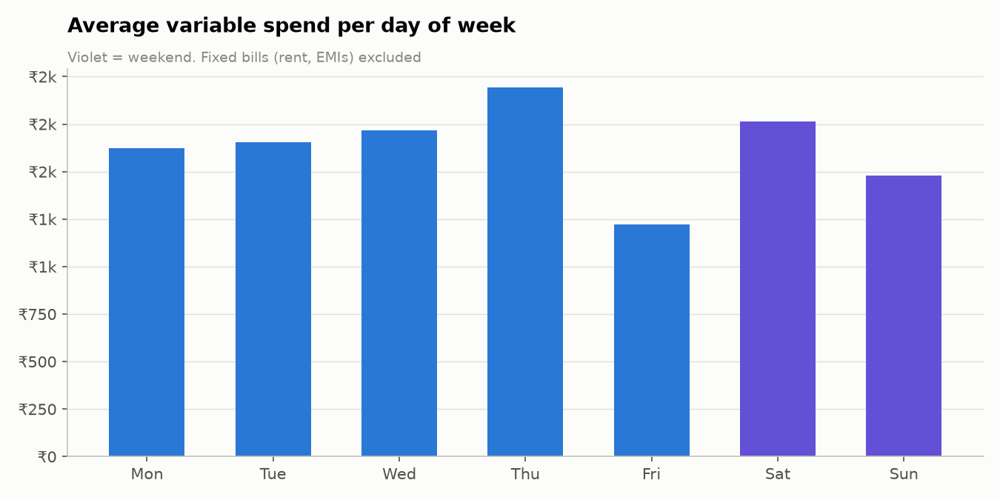
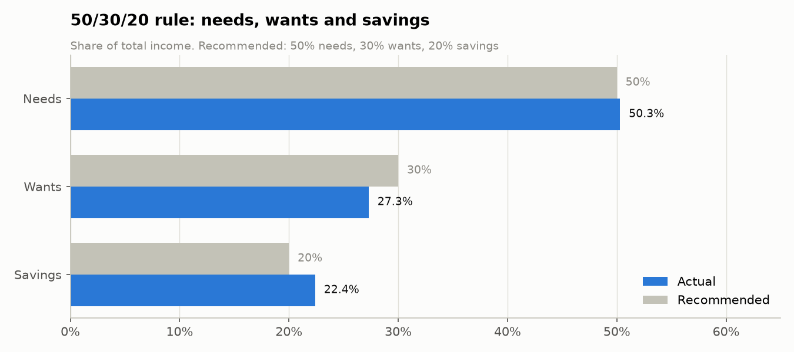

# Personal Expense Tracker & Budget Dashboard: Insights Report

*Generated automatically on 26 November 2026 by `src/report_generator.py`*

## 1. Headline numbers (24 months)

| Metric | Value |
|---|---|
| Total income | ₹1,883,674 |
| Total expense | ₹1,460,802 |
| Net savings | ₹422,872 |
| Savings rate | 22.4% |
| Average monthly expense | ₹60,867 |
| Expense transactions | 1,221 |
| Top spending category | Rent |

## 2. Key insights

1. Over 24 months the user earned ₹1,883,674 and spent ₹1,460,802, saving ₹422,872 (savings rate 22.4%).
2. Top 3 spending categories: Rent (25.3%), Shopping (13.1%), Groceries (11.2%) - together 49.6% of all spending.
3. Best month: 2024-02 (saved ₹45,769). Worst month: 2025-03 (net -₹5,414).
4. Spending exceeded income in 2 month(s): 2024-07, 2025-03.
5. Shopping went over budget in 16 of 24 months (overall 123.0% of budget used).
6. Education went over budget in 10 of 24 months (overall 120.2% of budget used).
7. Entertainment went over budget in 13 of 24 months (overall 107.3% of budget used).
8. 50/30/20 check: savings are 22.4% of income, which meets the 20% target; wants take 27.3% (target 30%).
9. 94.6% of spending is digital; UPI alone is 41.3%.
10. Festive effect: Shopping in Oct-Nov is 1.6x a normal month - plan a dedicated Diwali fund.

## 3. Recommendations

1. Review the Shopping budget: when it is exceeded, overspend averages ₹4,097.
2. Review the Education budget: when it is exceeded, overspend averages ₹2,652.
3. Review the Entertainment budget: when it is exceeded, overspend averages ₹1,244.
4. Cutting food-delivery spend by 20% would save about ₹14,792 per year.
5. Automate a fixed SIP/RD transfer on salary day so the 20% savings target is met first.

## 4. Spending by category

| category | total_spent | avg_per_month | share_pct |
|---|---|---|---|
| Rent | ₹369,000 | ₹15,375 | 25.3% |
| Shopping | ₹191,944 | ₹7,998 | 13.1% |
| Groceries | ₹162,983 | ₹6,791 | 11.2% |
| Food & Dining | ₹147,922 | ₹6,163 | 10.1% |
| Transportation | ₹134,603 | ₹5,608 | 9.2% |
| Insurance | ₹89,800 | ₹3,742 | 6.2% |
| Utilities | ₹86,056 | ₹3,586 | 5.9% |
| Travel | ₹75,855 | ₹3,161 | 5.2% |
| Entertainment | ₹64,362 | ₹2,682 | 4.4% |
| Healthcare | ₹61,020 | ₹2,542 | 4.2% |
| Education | ₹43,272 | ₹1,803 | 3.0% |
| Subscriptions | ₹33,984 | ₹1,416 | 2.3% |

## 5. Budget performance

| category | total_budget | total_actual | utilisation_pct | months_over_budget | status |
|---|---|---|---|---|---|
| Shopping | ₹156,000 | ₹191,944 | 123.0% | 16 | Over Budget |
| Education | ₹36,000 | ₹43,272 | 120.2% | 10 | Over Budget |
| Entertainment | ₹60,000 | ₹64,362 | 107.3% | 13 | Over Budget |
| Food & Dining | ₹138,000 | ₹147,922 | 107.2% | 12 | Over Budget |
| Healthcare | ₹60,000 | ₹61,020 | 101.7% | 10 | Over Budget |
| Insurance | ₹89,800 | ₹89,800 | 100.0% | 0 | Near Limit |
| Rent | ₹369,000 | ₹369,000 | 100.0% | 0 | Near Limit |
| Subscriptions | ₹36,000 | ₹33,984 | 94.4% | 0 | Near Limit |
| Transportation | ₹144,000 | ₹134,603 | 93.5% | 11 | Near Limit |
| Groceries | ₹198,000 | ₹162,983 | 82.3% | 8 | Near Limit |
| Utilities | ₹108,000 | ₹86,056 | 79.7% | 6 | Within Budget |
| Travel | ₹108,000 | ₹75,855 | 70.2% | 8 | Within Budget |

## 6. Cash flow

## 7. Behaviour

## 8. Data-quality work performed

- Loaded raw data: 1,303 rows, 8 columns
- Removed 25 duplicate rows
- Standardised 191 dates written in non-ISO formats; dropped 0 unparseable dates
- Converted 102 text amounts to numbers; fixed 11 negative amounts; dropped 0 rows with no amount
- Standardised 51 transaction-type labels (DR/CR -> Debit/Credit)
- Standardised 102 inconsistent category spellings
- Filled 25 of 25 missing categories using merchant name (0 left as 'Uncategorised')
- Filled 38 missing payment modes with 'Unknown' (not guessed, to stay honest)
- Removed 3 data-entry errors (amount > 20x merchant median): Swiggy ₹31,950, Starbucks ₹60,631, Domino's ₹70,597
- Flagged 69 genuine large spends using the IQR rule (kept in data)
- Added features: year, month, month_name, year_month, quarter, day_of_week, is_weekend, signed_amount, expense_type, cost_nature, is_large_spend
- Final clean data: 1,275 rows, 19 columns, 0 missing values remaining
